# Stecktec EIC – Easy Irrigation Control

**Ein modulares, solarbetriebenes Bewässerungssystem mit eigenen Platinen, LoRa-Funk, Mobilfunk-Anbindung und Smartphone-App.**

Maturaprojekt (Abschlussprojekt) im Schuljahr 2024/25 an der Technologischen Fachoberschule Meran „Oskar von Miller“, Fachrichtung Elektrotechnik – von Felix Steck.

<p align="center">
  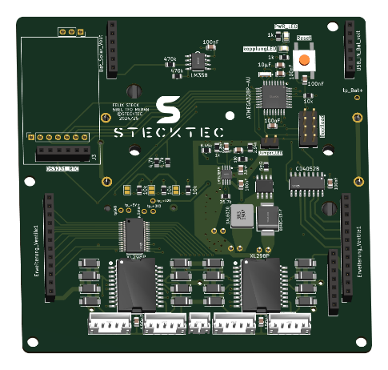
  &nbsp;
  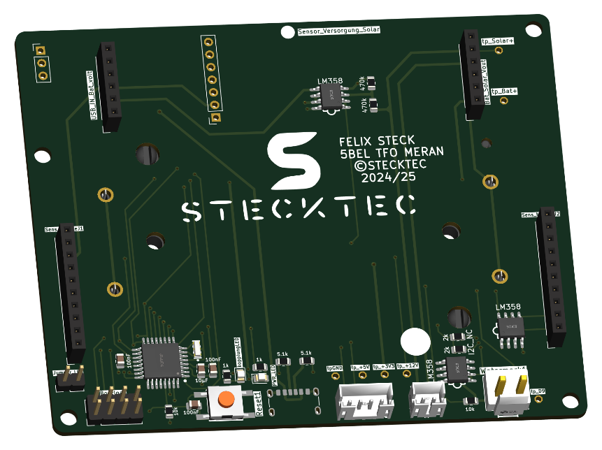
</p>

<p align="center"><em>Hauptplatine (links) und Sensorplatine (rechts) – beide selbst in KiCad entworfen</em></p>

**Die komplette Projektdokumentation (64 Seiten) liegt hier: [docs/Projektdokumentation_StecktecEIC.pdf](docs/Projektdokumentation_StecktecEIC.pdf)**

---

## Inhalt

- [Was ist Stecktec EIC?](#was-ist-stecktec-eic)
- [Idee und Motivation](#idee-und-motivation)
- [Wie das System funktioniert](#wie-das-system-funktioniert)
- [Hardware](#hardware)
- [Software](#software)
- [Was nicht nach Plan lief](#was-nicht-nach-plan-lief)
- [Projekt in Zahlen](#projekt-in-zahlen)
- [Aufbau des Repositorys](#aufbau-des-repositorys)
- [Fazit](#fazit)
- [Lizenz](#lizenz)

---

## Was ist Stecktec EIC?

Stecktec EIC ist ein modulares intelligentes Bewässerungssystem, das speziell für den Einsatz im Obst- und Beerenanbau, aber auch für private Gärten konzipiert wurde. Es besteht aus mehreren modularen Teilen und kann verschiedene Werte wie die Bodenfeuchtigkeit, Temperatur und Luftfeuchtigkeit messen und Bewässerungsventile schalten. Alles wird über eine benutzerfreundliche Smartphone-App gesteuert und überwacht. Das ermöglicht dem Bauern eine optimale Übersicht und Kontrolle über seine Felder.

**EIC** steht für **Easy Irrigation Control** – eine einfache und effiziente Steuerung der Bewässerung, mit dem Ziel, den Wasserverbrauch zu verringern.

Kurz gesagt kann das System:

- **Bodenfeuchte messen** – mit einem Watermark-Saugspannungssensor (Irrometer 200SS), der misst, wie viel Wasser die Pflanze wirklich aus dem Boden ziehen kann
- **Temperatur und Luftfeuchtigkeit messen** (BME280)
- **Magnetventile schalten** – bistabile 12-V-Ventile, die nur beim Umschalten Strom brauchen
- **Kilometerweit funken** – Sensorstationen sprechen per LoRa mit der Hauptstation
- **Online gehen** – die Hauptstation ist per Mobilfunk (SIM7000) mit einer Firebase-Datenbank verbunden
- **Per App bedient werden** – eigene React-Native-App für Android und iOS
- **Autark laufen** – 18650-Akkus, die über ein kleines Solarpanel geladen werden

## Idee und Motivation

Die Idee zum EIC-Bewässerungssystem entstand aus der Beobachtung, dass viele bestehende landwirtschaftliche Bewässerungslösungen entweder zu teuer, zu kompliziert oder unzureichend automatisiert sind. Insbesondere kleinere landwirtschaftliche Betriebe oder Privatpersonen verfügen häufig nicht über die Mittel, um teure Systeme mit vielen unnötigen Funktionen zu implementieren. Ziel war es daher, ein kostengünstiges, modulares und leicht erweiterbares System zu entwickeln, das zuverlässig arbeitet und sich an verschiedene Bedürfnisse anpassen lässt.

Ein weiterer wichtiger Beweggrund war die zunehmende Regulierung des landwirtschaftlichen Wasserverbrauchs. Die Anforderungen an einen sparsamen und nachhaltigen Umgang mit Wasser steigen stetig. Bereits heute wird vielerorts auf ressourcenschonende Systeme wie Tröpfchenbewässerung umgestellt. Eine intelligente Steuerung kann diesen Trend weiter unterstützen, indem sie den Wasserverbrauch anhand aktueller Sensordaten zusätzlich optimiert und nur dann bewässert, wenn es tatsächlich notwendig ist.

Die Idee kam direkt vom eigenen Apfelbetrieb der Familie in Südtirol: Mein Vater hat oft davon gesprochen, wie praktisch ein intelligentes Bewässerungssystem wäre – und ich wollte ein Projekt umsetzen, das einen echten Nutzen im Alltag hat.

## Wie das System funktioniert

Das System besteht aus einer **Hauptstation** und einer oder mehreren **Sensorstationen**, die im Feld verteilt werden. Jede Station hat ihre eigene Basisplatine mit Mikrocontroller, Akku und Solarversorgung.

<p align="center">
  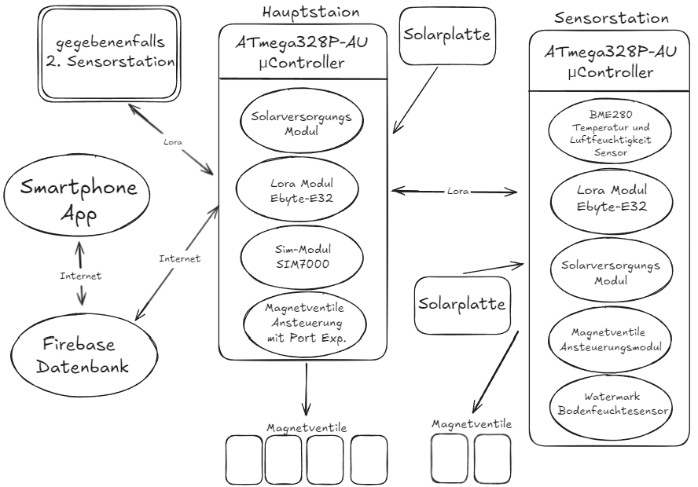
</p>

Die grafische Darstellung veranschaulicht, wie alle einzelnen Komponenten miteinander kommunizieren – sei es über LoRa, Internet oder über direkte Hardwareverbindungen.

Der Datenfluss im Überblick:

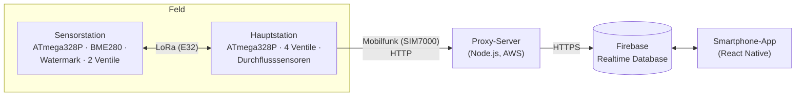

1. Die **Hauptstation** schickt alle paar Sekunden ein JSON-Paket per LoRa an die Sensorstation – darin stehen u. a. die gewünschten Ventilzustände.
2. Die **Sensorstation** schaltet daraufhin ihre Ventile und antwortet mit ihren Messwerten (Temperatur, Luftfeuchtigkeit, Bodenfeuchte, Durchflussstatus).
3. Die Hauptstation lädt die Werte über das **SIM7000-Modul** in die **Firebase-Datenbank** hoch und liest dort die Ventilbefehle aus der App aus.
4. Da das SIM7000 kein HTTPS kann, Firebase aber nur HTTPS akzeptiert, sitzt dazwischen ein kleiner **Proxy-Server**, der die HTTP-Anfragen entgegennimmt und als HTTPS an Firebase weiterleitet.
5. In der **App** sieht man alle Wiesen, Sensorwerte als Diagramme und kann die Ventile manuell oder per Timer schalten.

## Hardware

Das gesamte System wurde bewusst modular aufgebaut, indem die Funktionen auf mehrere Unterplatinen verteilt wurden. Diese Aufteilung bietet entscheidende Vorteile in Bezug auf Wartung, Erweiterbarkeit und Fehlersuche. Durch die Trennung der Hauptfunktionen – wie Stromversorgung, Sensorik, Steuerung und Aktorik – auf eigene Platinen kann jede Komponente unabhängig getestet und bei Bedarf ausgetauscht oder erweitert werden, ohne das Gesamtsystem zu beeinträchtigen.

Alle Platinen wurden mit **KiCad** gezeichnet und bei **JLCPCB** gefertigt; bestückt habe ich sie selbst von Hand. Die Erweiterungsplatinen werden über beschriftete Pinheader mit Verdrehschutz auf die Basisplatinen gesteckt.

| Platine | Aufgabe | Ordner |
|---|---|---|
| **Hauptplatine V2** | Herzstück: ATmega328P, LoRa, SIM7000, 4 Ventile über Port-Expander + 2× L298, Analog-Multiplexer für Durchflusssensoren, 6 Lagen, 80 × 100 mm | [`hardware/01_Hauptplatine_V2`](hardware/01_Hauptplatine_V2) |
| **Sensorplatine** | ATmega328P, LoRa, BME280, Messschaltung für den Watermark-Sensor, 20-poliger Erweiterungsanschluss, 4 Lagen | [`hardware/02_Sensorplatine`](hardware/02_Sensorplatine) |
| **Magnetventilsteuerung** | Aufsteckmodul für die Sensorplatine: L298P-H-Brücke für 2 Ventile + 5→12-V-Step-Up (LM3478) | [`hardware/03_Magnetventilsteuerung`](hardware/03_Magnetventilsteuerung) |
| **Solarversorgung V2** | Laden der 18650-Akkus per Solarzelle oder 5-V-Netzteil (TP5400), 5 V + 3,3 V (DC-DC) | [`hardware/04_Solarversorgung_V2`](hardware/04_Solarversorgung_V2) |
| **Programmiergerät** | Brennt den Arduino-Bootloader und lädt danach Programme hoch – per USB-C, 2 Lagen | [`hardware/05_Programmiergeraet`](hardware/05_Programmiergeraet) |

<p align="center">
  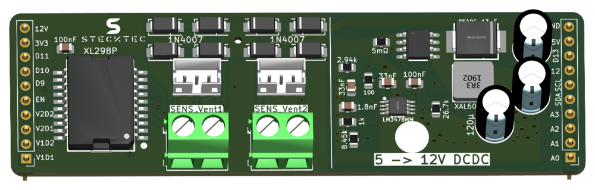
  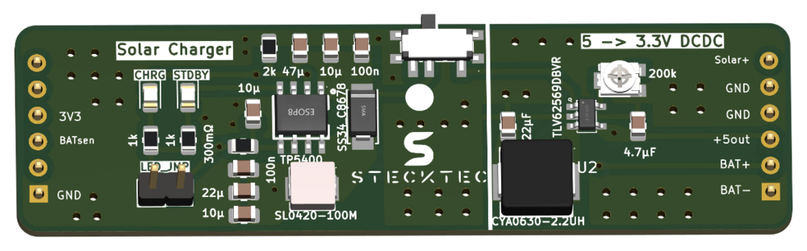
</p>
<p align="center">
  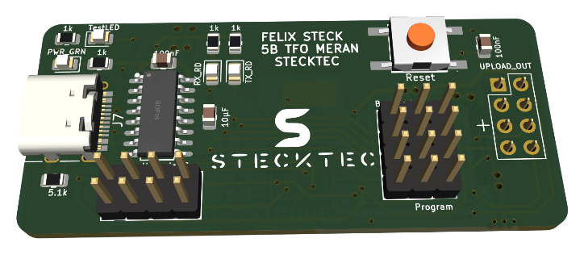
</p>

Jeder Hardware-Ordner enthält das KiCad-Projekt (Schaltplan + Layout), wo vorhanden ein Schaltplan-PDF, eine interaktive Bestückungsliste (`ibom.html`, einfach im Browser öffnen) und unter `production/` die Gerber-Dateien, Stückliste und Bestückungsdaten.

### Hauptplatine

Die Hauptplatine bildet das Herzstück der EIC und vereint zahlreiche zuvor beschriebene Hardwarekomponenten auf einer kompakten Leiterplatte. Der zentrale Mikrocontroller ATmega328P-AU (Arduino-kompatibel) steuert alle angeschlossenen Module und übernimmt die gesamte Systemlogik.

Aufgrund der hohen Schaltungskomplexität und auch dank eines günstigen Angebots des Herstellers JLCPCB fiel die Entscheidung zugunsten einer sechs-Layer Platine. Dies ermöglichte die Platzierung separater Versorgungspolygone für +5 V, +3.3 V und GND auf den inneren Layern. Dadurch blieben sowohl der oberste (Top) als auch der unterste (Bottom) Layer sowie Layer 4 weitgehend frei von Versorgungsleitungen, was erheblich Platz für die Signalführung schuf und das Routen erleichterte.

Weitere Design-Entscheidungen: Testpunkte für die Inbetriebnahme, große Bauteile (SIM-Modul, Elkos, Akkuhalter) auf der Rückseite, alle Bauteile von Hand lötbar, und der 12-V-Step-Up für die Ventile wurde mit TI WEBENCH dimensioniert.

<p align="center">
  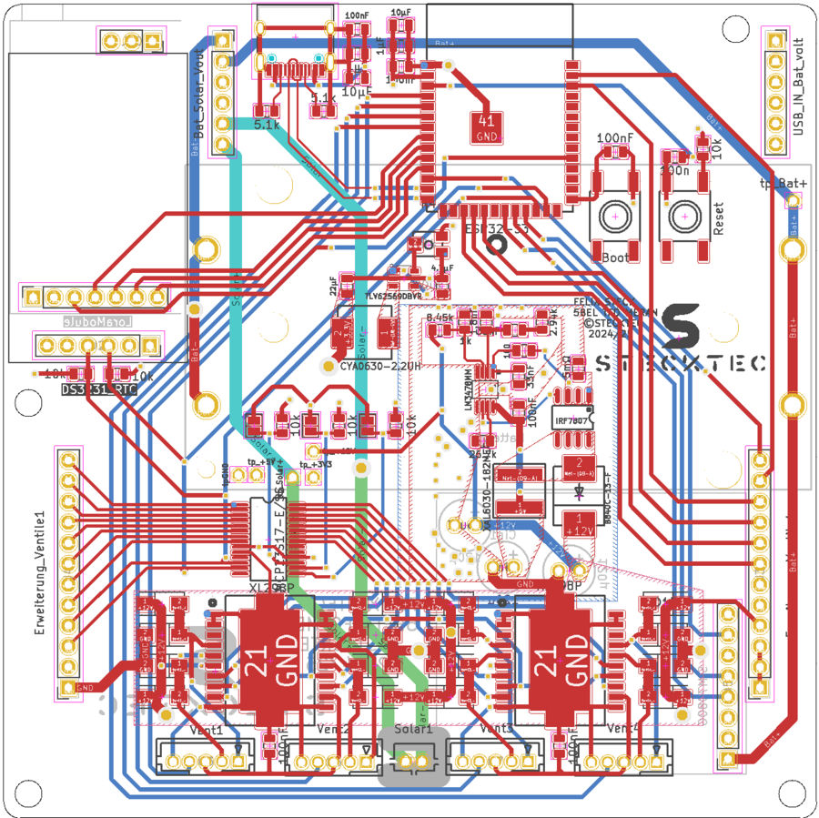
  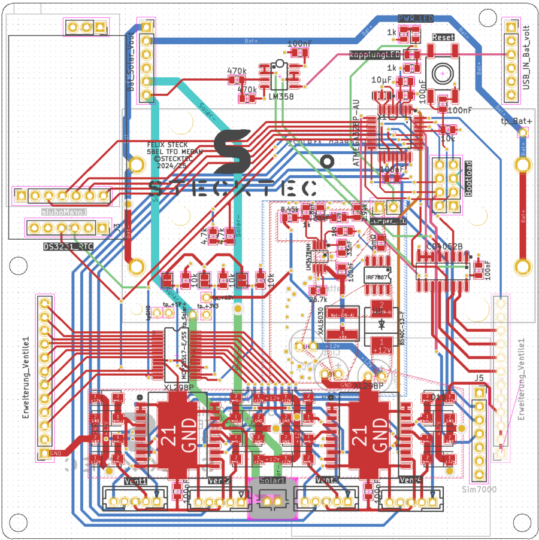
</p>
<p align="center"><em>Layout der Hauptplatine: V1 mit ESP32-S3 (links) und die finale V2 mit ATmega328P (rechts)</em></p>

### Sensorplatine

<p align="center">
  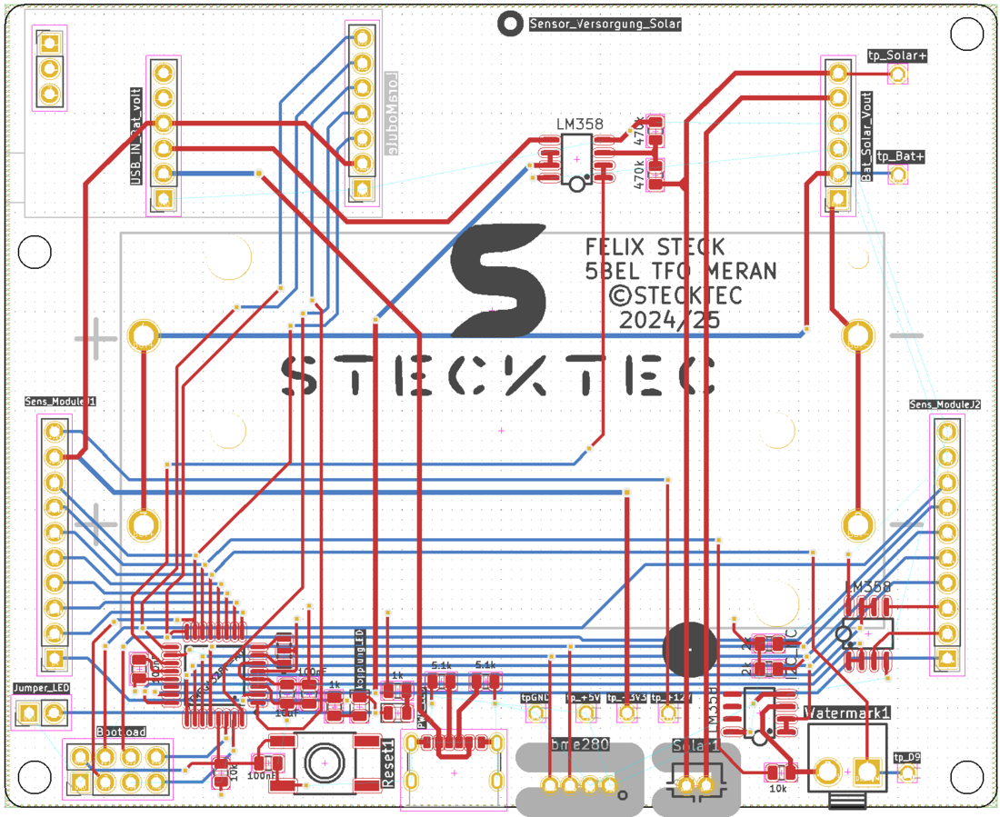
</p>

Für Erweiterungen verfügt die Sensorplatine über zwei Pinheader, auf die Zusatzmodule aufgesteckt werden können – zum Beispiel die Ventilsteuerungsplatine, mit der über eine H-Brücke (L298) zwei Magnetventile angesteuert werden können. Die Belegung der Pinheader wurde bewusst so gestaltet, dass auch beliebige andere Erweiterungen realisierbar sind.

Der **Watermark-Sensor** wird nicht dauerhaft, sondern nur kurz für die Messung bestromt – und die Polarität wird dabei umgedreht. Sonst würden Elektrolyseprozesse im Sensor die Messwerte verfälschen und seine Lebensdauer verkürzen.

### Programmiergerät

Um den Umgang mit dem ATmega Chip zu erleichtern, habe ich ein eigenes Programmiergerät entwickelt, das zwei zentrale Funktionen in einem kompakten Aufbau vereint: das Brennen des Bootloaders auf einen ATmega328P-Mikrocontroller und das anschließende Hochladen von Programmen. Außerdem kann durch die Code-Upload-Funktion der Platz und die Kosten für die USB-TTL-Converter-Schaltung auf der zu programmierenden Platine eingespart werden, was sich vor allem bei einer Serienproduktion lohnen würde.

Über vier Jumperleisten wechselt man zwischen **Bootloader-Modus** (das Gerät arbeitet wie ein Arduino Nano als ISP-Programmer über SPI) und **Code-Upload-Modus** (der USB-TTL-Wandler wird direkt mit dem Zielchip verbunden, der PC erkennt das Ganze wie einen normalen Arduino Nano).

Passende 3D-Druck-Gehäuse für Sensorstation und Programmiergerät liegen in [`hardware/3D-Gehaeuse`](hardware/3D-Gehaeuse).

## Software

| Teil | Technik | Ordner |
|---|---|---|
| Firmware Hauptplatine | C++ / PlatformIO, TinyGSM, EByte-LoRa-E32-Library, Adafruit MCP23X17, ArduinoJson | [`firmware/hauptplatine`](firmware/hauptplatine) |
| Firmware Sensorplatine | C++ / PlatformIO, EByte-LoRa-E32-Library, BME280_Light | [`firmware/sensorplatine`](firmware/sensorplatine) |
| Testprogramme | Einzeltests für jede Baugruppe (LoRa, SIM7000, H-Brücke, Watermark, I²C …) | [`firmware/tests`](firmware/tests) |
| Proxy-Server | Node.js / Express, HTTP → HTTPS zu Firebase | [`server/proxy`](server/proxy) |
| Smartphone-App | React Native (Expo), Firebase Auth + Realtime Database | [`app`](app) |

### LoRa-Kommunikation

Die Kommunikation zwischen der Hauptplatine und der Sensorplatine erfolgt über das LoRa E32-Modul und ist bidirektional durch die sogenannte Master-Slave-Kommunikation. Das bedeutet, die Hauptplatine sendet ein Datenpaket, auf das das Sensor-Modul mit einer Antwort reagiert. Die Sensorplatine sendet ein Datenpaket nur dann, wenn sie zuvor ein Datenpaket von der Hauptplatine empfangen hat. Dieses Kommunikationssystem hilft, den Stromverbrauch der Sensorplatine erheblich zu minimieren.

### Ventilansteuerung

Weil einfache H-Brücken-ICs verwendet werden, darf es beim Umschalten nie einen Moment geben, in dem beide Steuerpins gleichzeitig einen Kurzschluss verursachen. Deshalb wird zuerst der Enable-Pin deaktiviert, dann umgeschaltet, und erst danach wieder freigegeben (siehe [`firmware/hauptplatine/src/MainFunctions.h`](firmware/hauptplatine/src/MainFunctions.h)).

### Mobilfunk und Datenbank

Die Hauptplatine baut die Mobilfunkverbindung (Hologram-IoT-SIM) nur kurz für jede Anfrage auf und trennt sie danach wieder, um Strom zu sparen. Zwei Funktionen reichen für die gesamte Kommunikation: `putValue(path, value)` schreibt einen Wert in die Datenbank, `getValue(path)` liest einen aus.

Die Entwicklung dieses Teils war eine der komplexesten Phasen im Projekt und erstreckte sich über mehrere Monate, was auch den Zeitplan etwas durcheinanderbrachte. Erst nach umfassender Recherche und Debugging konnte eine stabile Anbindung an die Firebase-Datenbank realisiert werden.

### Smartphone-App

<p align="center">
  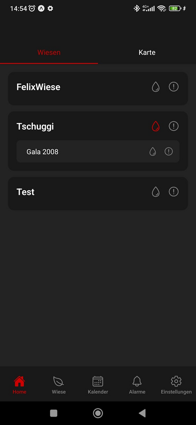
  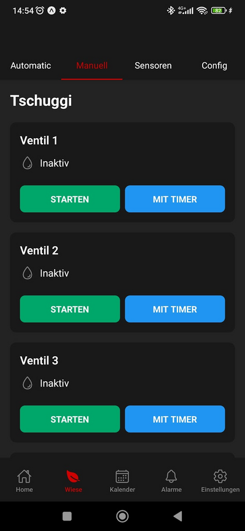
  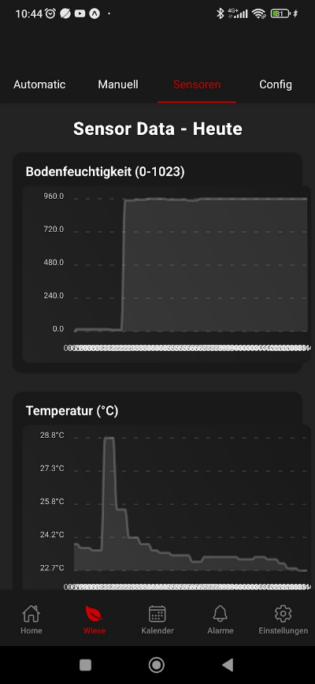
  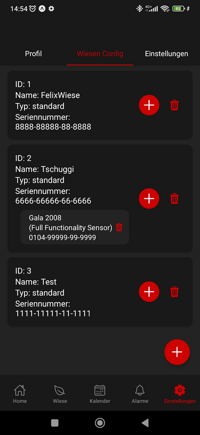
</p>

Im Tab „Wiesen Config“ können neue Wiesen angelegt und bestehende verwaltet werden. Jeder Eintrag enthält eine eindeutige ID, einen frei wählbaren Namen und die Seriennummer der dazugehörigen Hauptplatine. Zu jeder Wiese (Hauptmodul) können bis zu fünf Sensormodule hinzugefügt werden. Durch ein Rufzeichen-Symbol ist sofort erkennbar, bei welcher Wiese ein Problem vorliegt.

Im Bereich **Manuell** lassen sich die Ventile direkt oder per Timer schalten (praktisch z. B., um ein Leck im Tropfschlauch zu finden), unter **Sensoren** werden die Messwerte als Diagramme angezeigt. Der **Automatik**-Modus (Bewässerung nach Zeitplan oder Bodenfeuchte) war zum Projektende noch in Entwicklung.

## Was nicht nach Plan lief

Ein großer Teil des Projekts war Fehlersuche – und genau daraus habe ich am meisten gelernt:

- **ESP32-S3 → ATmega328P:** Die erste Hauptplatine basierte auf einem ESP32-S3. Das Hochladen war extrem unzuverlässig, und trotz deaktiviertem WLAN und Bluetooth lag der Ruhestrom bei über 100 mA – viel zu viel für ein Solar-System. Also habe ich zügig eine V2 mit dem ATmega328P entworfen, der auf der Sensorplatine schon funktionierte.
- **SIM7080G → SIM7000:** Das ursprünglich geplante SIM7080G-Modul ließ sich nicht in Betrieb nehmen; erst mit dem SIM7000 klappte die Verbindung. Auch der Versuch, das Modul direkt über AT-Befehle zu steuern, scheiterte an unzuverlässigen Antworten – die TinyGSM-Library war die Lösung.
- **Solarversorgung V1:** Der Laderegler (CN3791) und der Schutz-IC (DW01A) funktionierten auf der ersten Version nicht, vermutlich wegen Layoutfehlern. Für die V2 habe ich auf den TP5400 gewechselt und den Layoutvorschlag aus dem Datenblatt fast 1:1 übernommen – danach lief sie auf Anhieb.
- **Der falsche Chip:** Es gibt zwei nahezu baugleiche Modelle – den MCP23017 und den MCP23S17. Der entscheidende Unterschied besteht darin, dass der MCP23017 über I2C und der MCP23S17 über SPI angesteuert wird. Dies habe ich bei der Bestellung jedoch übersehen und versehentlich den MCP23S17 bestellt und aufgelötet. Nachdem ich den korrekten MCP23017 eingebaut hatte, funktionierte der Port Expander auf Anhieb problemlos.
- **Offene Punkte:** Der gleichzeitige Betrieb von Port-Expander und SIM-Modul führte noch zu Fehlfunktionen (vermutlich Timer- bzw. Library-Konflikte), und der ATmega328P stößt mit allen Modulen gleichzeitig an seine Grenzen.

Die ersten Versionen von Hauptplatine und Solarversorgung liegen zum Vergleich in [`hardware/archiv_V1`](hardware/archiv_V1).

## Projekt in Zahlen

| | |
|---|---|
| Zeitraum | Schuljahr 2024/25, 35 Wochen |
| Arbeitsstunden | **307 h** (Schule, zu Hause und offenes Labor) |
| Eigene Platinen-Designs | 7 (davon 5 in der finalen Version) |
| Materialkosten Prototyp | **ca. 424 €** (Platinen 57 €, Bauteile 168 €, Module 199 €) |
| Geschätzte Kosten in Serie (100 Stk.) | ca. 307 € pro komplettem System |
| Akkulaufzeit ohne Nachladen | ca. eine Woche |

Projektantrag, Pflichtenheft und weitere Planungsunterlagen liegen in [`docs/projektmanagement`](docs/projektmanagement).

## Aufbau des Repositorys

```
├── app/                     React-Native-App (Expo)
├── docs/
│   ├── Projektdokumentation_StecktecEIC.pdf
│   ├── Auslageblatt.pdf
│   ├── images/              Bilder für dieses README
│   └── projektmanagement/   Projektantrag, Pflichtenheft, Blockschaltbild
├── firmware/
│   ├── hauptplatine/        Finaler Code Hauptplatine (PlatformIO)
│   ├── sensorplatine/       Finaler Code Sensorplatine (PlatformIO)
│   └── tests/               Testprogramme für die einzelnen Baugruppen
├── hardware/
│   ├── 01_Hauptplatine_V2/
│   ├── 02_Sensorplatine/
│   ├── 03_Magnetventilsteuerung/
│   ├── 04_Solarversorgung_V2/
│   ├── 05_Programmiergeraet/
│   ├── 3D-Gehaeuse/         STL-Dateien für den 3D-Druck
│   └── archiv_V1/           Erste Versionen (Hauptplatine mit ESP32, Solarversorgung V1)
└── server/proxy/            Node.js-Proxy zwischen SIM-Modul und Firebase
```

**Hinweis zum Nachbauen:** Zugangsdaten (Firebase-Konfiguration, Proxy-IP, Service-Account-Schlüssel) wurden aus dem öffentlichen Code entfernt und durch Platzhalter wie `YOUR_PROXY_IP` bzw. `YOUR_API_KEY` ersetzt. Wer das System selbst aufsetzen möchte, braucht ein eigenes Firebase-Projekt und einen eigenen Server für den Proxy.

## Fazit

Mit dem EIC-Bewässerungssystem wurde ein praxisnahes und zukunftsorientiertes Projekt umgesetzt, das moderne Technik mit den realen Anforderungen der Landwirtschaft verbindet.

Natürlich lief nicht alles exakt nach Plan – einige Funktionen konnten innerhalb des Projektzeitraums nicht vollständig umgesetzt werden. Dennoch habe ich gerade aus diesen Herausforderungen wertvolle Erfahrungen gewonnen, die mir bei zukünftigen Projekten helfen werden, realistischer zu planen und flexibler auf unerwartete Schwierigkeiten zu reagieren.

Das Projekt hat meine Begeisterung für die Entwicklung intelligenter, nachhaltiger Lösungen gestärkt und mir gezeigt, wie viel Potenzial in der Verbindung von Technik und Umwelt steckt.

## Lizenz

Dieses Projekt steht – wie schon die Projektdokumentation – unter der Lizenz [Creative Commons Namensnennung – Nicht kommerziell 4.0 International (CC BY-NC 4.0)](https://creativecommons.org/licenses/by-nc/4.0/deed.de). Siehe [LICENSE](LICENSE).

Betreut von Martin De Tomaso und Ivan Huber, TFO Meran.
